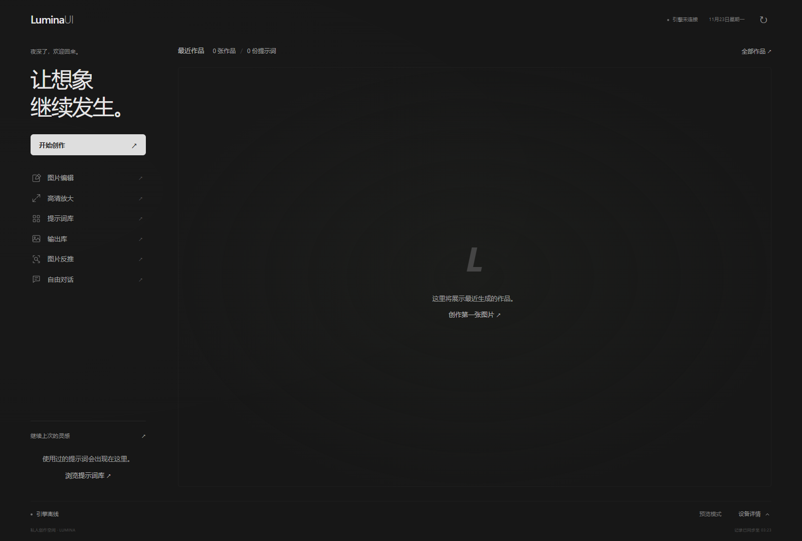
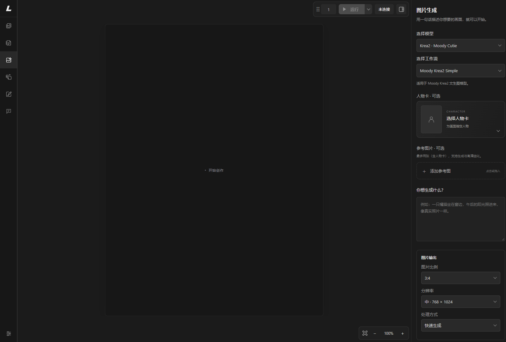
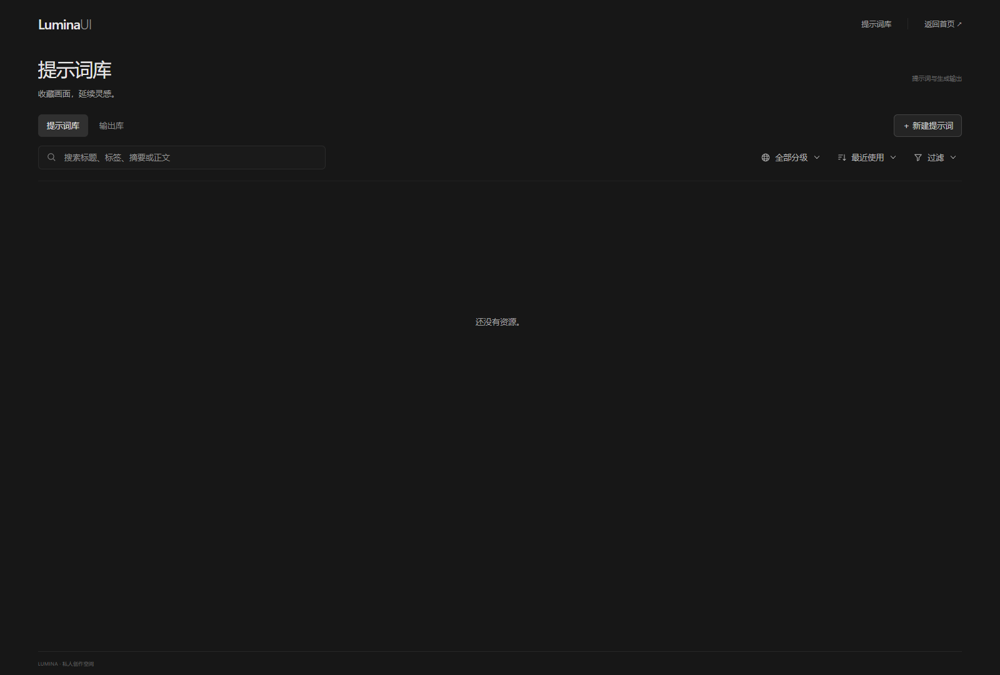

# LuminaUI

**本地 AI 图像工作台 · A local AI image workbench for Windows**

从参考图、提示词到局部编辑与高清输出，在同一个工作台完成。LuminaUI 将创作界面与本机 ComfyUI 队列连接起来，并提供 Electron 桌面入口。

Work from a reference image through a masked edit to a high-resolution export. LuminaUI connects a browser-based studio to a local ComfyUI queue and offers the same workspace in an Electron desktop shell.

**v0.1.0**　·　Windows　·　Electron + Python　·　ComfyUI

[界面导览 · Studio tour](#studio-tour)　 /　 [快速预览 · Preview](#preview)　 /　 [本地推理 · Local inference](#local-inference)　 /　 [项目结构 · Source map](#source-map)

*首页 · Home. 本文截图来自首版源码生成的空资料库预览。All screenshots show the first-version interface with an empty library.*

## 界面导览 · Studio tour

| 创作任务 / Task | 操作 / In the studio |
| --- | --- |
| **文字生图 · Text to image** | 选择工作流、画幅与种子，填写主体和场景后提交。Choose a workflow, aspect ratio and seed, then describe the subject and scene. |
| **人物一致性 · Character references** | 上传人物参考，可为附图指定服饰或背景等用途。Add a character reference and assign supporting images to roles such as clothing or background. |
| **局部编辑 · Masked editing** | 用画笔或矩形选区标出修改范围，预览合成后的边缘。Brush or box the area to change, then inspect the blended boundary. |
| **高清放大 · Upscaling** | 选取源图、倍率和对应的放大模型，比较纹理与轮廓。Select an input, scale and upscaler, then compare texture and edge detail. |

**一个局部编辑示例 · A first masked edit**

1. 在工作台选择图片编辑，上传一张有清晰主体的照片。Open image editing and upload a photo with a distinct subject.
2. 用画笔涂出衣袖，输入「把衣袖改为深蓝色，保留褶皱」。Brush over the sleeve and enter “Change the sleeve to navy blue and preserve the folds.”
3. 生成后用滑动对比检查袖口，再决定是否调整选区或羽化。Use the comparison slider to inspect the cuff, then refine the mask or feathering as needed.

**复用创作资料 · Reusing creative assets**　提示词库用于查找和复用描述，角色卡保存人物设定，LoRA 管理器组织生成时使用的模型附加权重。Search the prompt library for reusable descriptions, keep character details in cards, and organize optional generation weights in the LoRA manager.

## 快速预览 · Preview

在仓库根目录打开 PowerShell，安装好 Node.js 后运行以下命令。预览使用内置空数据，可浏览页面布局，无需下载模型。From the repository root on Windows, run the following with Node.js installed. The preview uses fixtures so you can explore the layout before setting up inference.

~~~powershell
node desktop/build-preview.cjs
Start-Process desktop/web-preview/home.html
~~~

要查看带原生窗口和标签页的桌面预览，使用 Electron 入口。For the desktop window and tab experience, install the locked desktop dependencies and launch preview mode.

~~~powershell
npm --prefix desktop ci
npm --prefix desktop run preview
~~~

## 本地推理 · Local inference

**环境基线 · Recorded environment**　首版记录使用 Python 3.13.12、PyTorch 2.14.0+cu130、本地 ComfyUI 提交 `8cfe5e1e`。实际显存需求由模型、分辨率和工作流决定。The source workstation used Python 3.13.12, PyTorch 2.14.0+cu130 and ComfyUI at the revision below. Memory use varies with model, image size and graph.

**1　准备引擎 / Prepare the engine**

在仓库根目录创建虚拟环境并检出记录的引擎版本。按硬件环境先安装支持 GPU 的 PyTorch，再安装 Python 依赖。Create the virtual environment and check out the recorded engine revision. Install a GPU-enabled PyTorch build appropriate for your hardware before installing the remaining dependencies.

~~~powershell
py -3.13 -m venv .venv
git clone https://github.com/Comfy-Org/ComfyUI.git ComfyUI
git -C ComfyUI checkout 8cfe5e1ecb97512dea8deaac15e1228d7e6feeb1
# Install the PyTorch build for your GPU here.
.\.venv\Scripts\python.exe -m pip install -r ComfyUI/requirements.txt -r requirements.txt
New-Item -ItemType Directory -Force tmp | Out-Null
Copy-Item nodes/* ComfyUI/custom_nodes/ -Recurse -Force
~~~

**2　装配一个工作流 / Provision one workflow**

从一个预设开始。打开预设的 API JSON，按节点中指定的文件名放置模型。Qwen 2.1 的清单记录了相对路径、大小和 SHA-256。第三方节点清单记录了原机器使用的仓库和提交，按所选图的节点类型安装相应组件及其依赖。Start with one preset. Match the filenames in its API graph to files under the engine’s model directories. For Qwen 2.1, use the recorded paths, sizes and hashes. Install the external node packs required by that graph at their recorded revisions and follow each pack’s setup instructions. [预设 / Presets](workflows/presets/manifest.json) · [权重清单 / Weight manifest](workflows/qwen21_model_manifest.json) · [节点版本 / Node revisions](workflows/node-versions.json)

**3　启动工作台 / Open the studio**

~~~powershell
.\start_webui.bat
~~~

浏览器工作台位于 `http://127.0.0.1:8190`，引擎位于 `http://127.0.0.1:8188`。工作台会复用已启动的引擎。安装 Electron 依赖后，也可运行 `.\start_desktop.bat`。The studio serves on port 8190 and reuses the local engine on port 8188. With the desktop dependencies installed, the desktop launcher opens the live studio in Electron.

| 遇到的问题 / Symptom | 检查位置 / What to inspect |
| --- | --- |
| 引擎启动超时 / Engine startup times out | 查看 `webui/data/comfyui.log` 的首个导入错误，并检查 GPU 版 PyTorch。Read the first import error in the engine log and check the GPU build. |
| 节点或模型缺失 / Missing node or model | 核对图中的节点类型、模型目录和完整文件名。Compare node types, model directories and exact filenames with the workflow. |
| 预览无法生成 / Preview does not render images | 使用上面的本地推理入口，并确认引擎能够加载所选图。Use the live launcher above and confirm the engine can load the selected graph. |

## 项目结构 · Source map

| 路径 / Path | 内容 / Contents |
| --- | --- |
| `desktop/` | Electron 外壳、标签页、后端进程管理和预览生成器。Desktop shell, tabs, backend lifecycle and preview builder. |
| `webui/` | Python HTTP 服务和浏览器工作台。Python HTTP service and browser studio. |
| `workflows/` | 预设、API 图和模型清单。Preset definitions, API graphs and model manifests. |
| `nodes/` | 本地安装所用的节点源码副本，按上方步骤复制到引擎。Node sources from the local installation, copied into the engine during setup. |

**数据与调用 · Data and requests**　默认上传目录为 `ComfyUI/input`，输出位于 `ComfyUI/output`，任务记录位于 `webui/data`。使用云端提示词或识图助手时，所选服务会接收该次请求中的内容。Uploads, renders and job history use those local folders by default. When a cloud assistant is selected, the configured provider receives the content of that request.

**首版范围 · Snapshot scope**　此私密快照保存应用源码、图定义、节点版本与界面预览。模型权重、个人资料库、生成物和 API 配置由部署者自行准备。第三方组件保留各自许可。This private snapshot records application sources, graph definitions, node revisions and interface previews. Supply model weights and service credentials locally. Third-party components retain their respective licenses.
